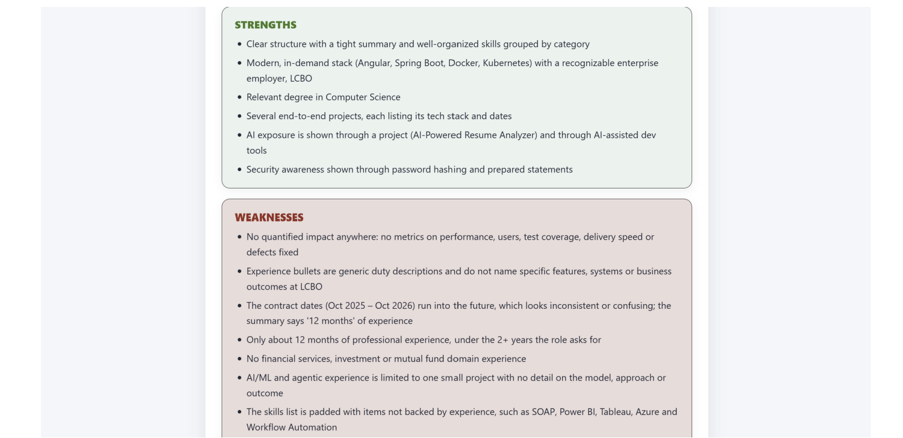
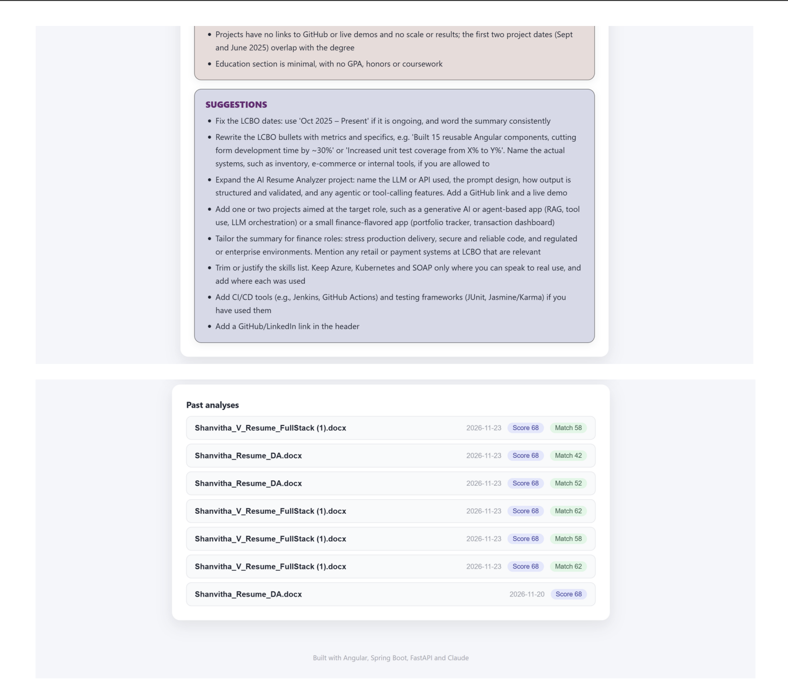

# AI Resume Analyzer

Upload a resume (PDF or DOCX), optionally paste a job description, and get instant AI feedback: an overall score, a job-match score, skills found, missing keywords, strengths, weaknesses, and specific suggestions. Past analyses are saved and can be reopened.





## Architecture

```
Angular (4200)  →  Spring Boot (8080)  →  FastAPI (8000)  →  Claude API
                        │
                      MySQL
```

| Layer | Tech | Responsibility |
|---|---|---|
| Frontend | Angular, TypeScript, SCSS | Upload form, score rings, results, history |
| Backend | Spring Boot 4, Java, JPA | REST API, validation, error handling, saves history |
| AI service | Python, FastAPI, Pydantic | Extracts text (pdfplumber, python-docx), calls Claude, returns validated JSON |
| Database | MySQL | Stores each analysis |

## Highlights

- **Structured LLM output:** Claude fills a Pydantic-generated tool schema, and the result is validated before it is returned.
- **Prompt-injection defense:** resume and job-description text is wrapped in tags and treated as untrusted data.
- **Clear errors end to end:** wrong file type, file too large, scanned PDF, and AI service down each return a friendly message.
- **Separation of concerns:** the AI service is independent, so the model can be swapped without touching the Java code.

## Run with Docker (recommended)

Requirements: Docker Desktop and an Anthropic API key.

```
copy .env.example .env      # then fill in your real values
docker compose up --build -d
```

Open http://localhost:4200. Stop everything with `docker compose down`.

## Run it locally

**Requirements:** JDK 17+, Node 18+, Python 3.10+, MySQL 8, and an Anthropic API key.

### 1. Database

```sql
CREATE DATABASE resume_analyzer;
CREATE USER 'resume_app'@'localhost' IDENTIFIED BY 'your-password';
GRANT ALL PRIVILEGES ON resume_analyzer.* TO 'resume_app'@'localhost';
```

### 2. AI service

```
cd ai-service
python -m venv venv
venv\Scripts\activate
pip install -r requirements.txt
copy .env.example .env      # then add your real API key
uvicorn main:app --reload --port 8000
```

### 3. Backend

```
cd backend/src/main/resources
copy application.properties.example application.properties   # then set your DB password
cd ../../../..
mvnw spring-boot:run
```

### 4. Frontend

```
cd frontend
npm install
ng serve
```

Open http://localhost:4200.

## API

| Method | Endpoint | Description |
|---|---|---|
| POST | `/api/analyze` | Multipart: `file`, optional `jobDescription` |
| GET | `/api/history` | 20 most recent analyses |
| GET | `/api/history/{id}` | One saved analysis |
| GET | `/api/health` | Health check |

## Challenges and what I have learned

**1. Spring Boot 4 changed Jackson's package.**
`ObjectMapper` moved from `com.fasterxml.jackson.databind` to `tools.jackson.databind`, and Jackson 3 no longer throws checked `IOException`s. I read the compiler errors, found the new package, and adjusted the `catch` blocks. *Lesson: major framework upgrades change APIs, so read the error and the release notes before assuming your code is wrong.*

**2. Uploads failed silently with "Is the backend running?"**
Angular showed a generic error, but the real cause was in the Spring Boot log: `MaxUploadSizeExceededException`. Spring's default upload limit is 1 MB. I raised `spring.servlet.multipart.max-file-size` to 5 MB to match the Python service. *Lesson: when the UI shows a vague error, check each layer's logs, starting from the backend.*

**3. Scores did not display because of a field-name mismatch.**
Python returns `overall_score`, Java uses `overallScore`, and `@JsonProperty` made Spring send the underscore name to Angular, which then read `undefined`. I confirmed it by calling the API directly in the browser, then switched to `@JsonAlias` so Java accepts the Python name but sends camelCase. *Lesson: verify the actual JSON on the wire instead of assuming it, and keep naming conventions consistent across services.*

**4. A model rejected forced tool choice.**
Claude returned a 400 error for `tool_choice` of type `tool`. I switched to `auto` and relied on a clear system prompt. *Lesson: model capabilities differ, and the API's error messages are specific, so read them.*

**5. Keeping secrets out of Git.**
I moved the API key into `.env` and the database password into `application.properties`, both git-ignored, and committed `.example` templates instead. Before the first push I searched the whole Git history for secrets. *Lesson: check history before pushing, because deleting a leaked file later does not remove it from past commits.*

**6. CSS conic-gradient rings were unreliable.**
My CSS-variable ring rendered as a flat circle. I replaced it with an SVG circle whose arc length is calculated from the score. *Lesson: choose the simpler, more portable technique when a clever one fails.*

**What I would do differently**

- Add automated tests (pytest for the AI service, JUnit for the backend) from the start.
- Define the JSON contract once (for example an OpenAPI spec) so the three services cannot drift apart.
- Add authentication and per-user history early rather than last.

## Roadmap

- User accounts and per-user history (JWT)
- Docker Compose for one-command setup
- Deployment with a live demo link

