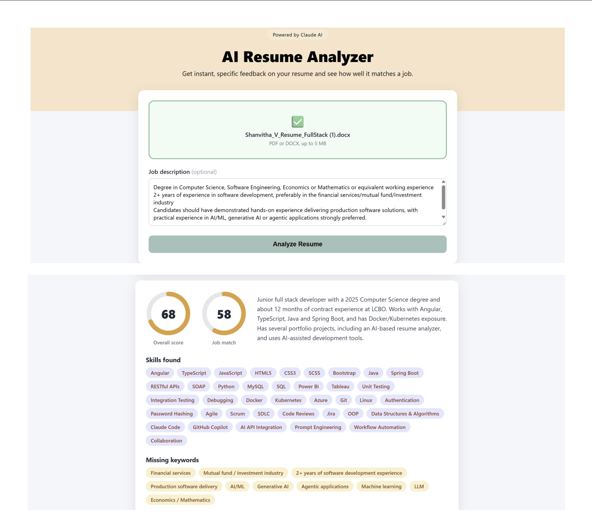

# AI Resume Analyzer

Upload a resume (PDF or DOCX), optionally paste a job description, and get instant AI feedback: an overall score, a job-match score, skills found, missing keywords, strengths, weaknesses, and specific suggestions. Past analyses are saved and can be reopened.




## Architecture

```
Angular (4200)  →  Spring Boot (8080)  →  FastAPI (8000)  →  Claude API
                        │
                      MySQL
```

| Layer | Tech | Responsibility |
|---|---|---|
| Frontend | Angular, TypeScript, SCSS | Upload form, score rings, results, history |
| Backend | Spring Boot 4, Java, JPA | REST API, validation, error handling, saves history |
| AI service | Python, FastAPI, Pydantic | Extracts text (pdfplumber, python-docx), calls Claude, returns validated JSON |
| Database | MySQL | Stores each analysis |

## Highlights

- **Structured LLM output:** Claude fills a Pydantic-generated tool schema, and the result is validated before it is returned.
- **Prompt-injection defense:** resume and job-description text is wrapped in tags and treated as untrusted data.
- **Clear errors end to end:** wrong file type, file too large, scanned PDF, and AI service down each return a friendly message.
- **Separation of concerns:** the AI service is independent, so the model can be swapped without touching the Java code.

## Run it locally

**Requirements:** JDK 17+, Node 18+, Python 3.10+, MySQL 8, and an Anthropic API key.

### 1. Database

```sql
CREATE DATABASE resume_analyzer;
CREATE USER 'resume_app'@'localhost' IDENTIFIED BY 'your-password';
GRANT ALL PRIVILEGES ON resume_analyzer.* TO 'resume_app'@'localhost';
```

### 2. AI service

```
cd ai-service
python -m venv venv
venv\Scripts\activate
pip install -r requirements.txt
copy .env.example .env      # then add your real API key
uvicorn main:app --reload --port 8000
```

### 3. Backend

```
cd backend/src/main/resources
copy application.properties.example application.properties   # then set your DB password
cd ../../../..
mvnw spring-boot:run
```

### 4. Frontend

```
cd frontend
npm install
ng serve
```

Open http://localhost:4200.

## API

| Method | Endpoint | Description |
|---|---|---|
| POST | `/api/analyze` | Multipart: `file`, optional `jobDescription` |
| GET | `/api/history` | 20 most recent analyses |
| GET | `/api/history/{id}` | One saved analysis |
| GET | `/api/health` | Health check |

## Roadmap

- User accounts and per-user history (JWT)
- Docker Compose for one-command setup
- Deployment with a live demo link